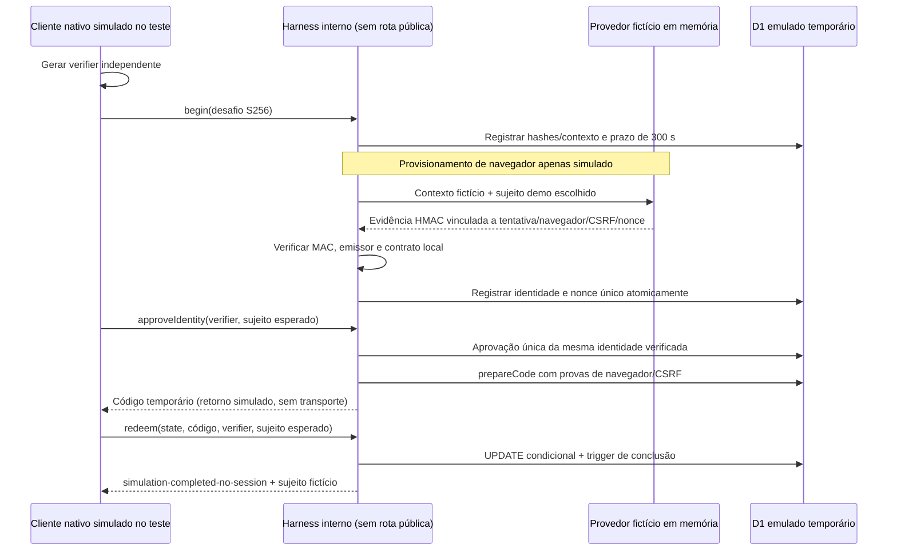

# Protocolo interno simulado com D1 — sem autenticação real

**Somente laboratório automatizado, sem endpoint público, Steam, sessão ou autorização.** Não está conectado ao Tauri nem ao navegador. A demonstração Windows aprovada continua usando sua autoridade Rust em memória. Não há flag que habilite este protocolo no Worker.

## Reuso e separação

- Reutiliza `authHash` da [preparação OpenID/D1](../backend/src/auth/D1OpenIdPreparation.server.ts), Web Crypto disponível no contrato Workers e o executor D1 temporário dos testes.
- Preserva integralmente as migrações 0001–0006, o [verificador OpenID](OPENID_VERIFIER.md), a composição de asserção/nonce e a [consulta de proveniência](../backend/src/auth/D1SessionProvenance.server.ts). Os testes existentes continuam cobrindo os contratos Steam com transporte simulado. Não há uma segunda implementação OpenID.
- Reaproveita o contrato S256 e a ordem intenção/aprovação/código do [laboratório Rust](DESKTOP_PAIRING.md), sem copiar seu parser HTTP, cookie local, listener ou Mutex para o Worker. O vetor público RFC 7636 confirma a conversão base64url → hexadecimal dos mesmos 32 bytes de digest. Não aplica hash adicional ao desafio.
- A [migração 0007](../backend/migrations/0007_isolated_simulation.sql) é necessária para **não** escrever evidências fictícias em `verified_openid_assertions`, `users`, `auth_attempts`, `desktop_grants` ou `sessions`. Acrescenta somente `simulation_attempts`, `simulation_assertions` e `simulation_grants`, sem FK para tabelas reais, sem backfill ou alteração dos guards anteriores. IDs são `demo:alice`/`demo:bob`, nunca SteamID64.
- Os módulos em [simulation](../backend/src/simulation/) não são importados pelo [entrypoint HTTP](../backend/src/index.ts). Um teste percorre suas importações locais para preservar essa separação. `/auth/*` continua 501, `/api/*` continua 401. Não há fallback de sessão, exportador para tabelas reais ou comando para converter evidência simulada em OpenID.

## Ciclo exercitado



`begin` devolve contexto **ao harness confiável**, não a uma interface ou endpoint. A entrega segura de `browserBinding`/CSRF ao navegador ainda não existe. A URL futura conteria somente referência de tentativa: conhecê-la não autoriza confirmação, emissão de código ou resgate. Não há polling, redirect, URL configurável ou listener novo nesta etapa.

| Informação | Responsável / circulação permitida no modelo |
| --- | --- |
| Verifier de 32 bytes em base64url canônico | Futuro Rust, somente memória nativa; nos testes, cliente fictício TypeScript. Enviado futuramente apenas no corpo HTTPS ao backend para aprovação/resgate, nunca React, URL, argv ou log. |
| Desafio S256 | Backend recebe base64url, grava os mesmos bytes em hexadecimal. Não identifica um executável legítimo nem impede relay. |
| State aleatório | Referência ao contexto; backend guarda hash. Nunca autoriza sozinho. |
| Prova do navegador e CSRF independentes | Harness os provisiona em memória. Banco guarda hashes. Cookies HTTPS e entrega/vínculo com o navegador correto permanecem pendentes. |
| Evidência fictícia | Provedor local usa chave HMAC não exportável e efêmera, sem arquivo/configuração ou segredo compartilhado com cliente. MAC cobre emissor fixo, sujeito fictício, hashes do contexto, nonce aleatório e timestamp. Não é assinatura Steam. |
| Código temporário | 32 bytes aleatórios, uma emissão por tentativa; banco guarda somente hash. Até 60 s e nunca além da tentativa. Não é bearer de sessão. |
| Resultado | Somente etapa e sujeito explícito `demo:*`; não concede acesso privado. |

O [provedor simulado](../backend/src/simulation/SimulatedIdentityProvider.server.ts) tem emissão explícita para o laboratório; qualquer teste que possua essa autoridade pode selecionar Alice ou Bob. Isso é uma fixture, não uma conta autenticada. A chave não é persistida: reiniciar/recriar a autoridade invalida envelopes antigos. Não reaproveitar essa autoridade, assinatura ou contrato como substituto da Steam.

## Regras e atomicidade

O [adaptador](../backend/src/simulation/D1SimulatedProtocol.server.ts) recebe DB e provedor de código interno, sem fetch padrão. Formatos/tamanhos são limitados; segredos exigem base64url canônico de exatamente 32 bytes; hashes SQL exigem 64 caracteres hexadecimais e 64 bytes, rejeitando NUL.

1. A tentativa guarda desafio, hashes de navegador/CSRF e prazos imutáveis. Expiração usa o relógio D1, não o relógio do cliente.
2. A gravação de identidade exige MAC válido e todos os vínculos exatos. O nonce não pode ter idade de 300 s ou mais, nem futuro acima de 60 s. INSERT/trigger revalidam prazo, cancelamento e unicidade. A identidade não pode ser substituída após registrada.
3. Aprovação exige verifier correspondente ao desafio e sujeito esperado igual ao sujeito da asserção. O registro é único/imutável. Conhecer cookie, state ou código não satisfaz essa prova. A ação modela confirmação, mas não comprova intenção humana ou destino real.
4. Emissão exige identidade e aprovação já persistidas e provas corretas de navegador/CSRF. UNIQUE por tentativa e guards impedem reemissão, inclusive REPLACE.
5. Resgate confere código, tentativa, S256, identidade esperada, cancelamento e expiração **na própria escrita**. A trigger atualiza a conclusão da tentativa na mesma instrução que consome o grant. Falha posterior reverte ambos. UPDATE sem linhas não é sucesso; não usar somente `meta.changes` (triggers também contam alterações).
6. Cancelamento exige posse nativa e compete com resgate por uma única transição terminal no D1 local. Concluído não vira cancelado e cancelado não conclui. Não há reativação ou extensão de prazo.
7. Falha/ambiguidade retorna código sanitizado, sem eco de input, SQL, MAC ou segredo. Se o commit ocorreu e a resposta se perdeu, o chamador recebe erro; novo resgate é recusado. Não existe retry que suponha sucesso ou emita autorização.

INSERT de evidência confia no adaptador/verificador como escritor privilegiado. SQL sozinho não comprova MAC, OpenID, intenção nem posse nativa; um administrador capaz de gravar SQL/alterar triggers está fora dessa garantia. Os testes por SQL exercitam constraints, não assinatura de identidade.

Retenção do laboratório é conservadora: DELETE e REPLACE são negados para não liberar replay por limpeza; FKs internas usam RESTRICT. Não há limpeza automática nem acoplamento com sessões válidas. Os testes descartam seus estados inteiros, criados temporariamente. Essa política seria inadequada para dados pessoais/tráfego público: definir retenção, quotas, tombstones e exclusão antes de qualquer uso real. A política de sessão real continua 1 h absoluta / 15 min inativa, sem alteração.

## Ameaças e resultado limitado

| Ameaça | Proteção exercitada / limite |
| --- | --- |
| Login CSRF / URL copiada | Provas independentes de navegador/CSRF e aprovação com posse são exigidas nas chamadas internas. **Não há prova de bootstrap de cookie HTTPS, Origin/Fetch Metadata ou intenção do navegador real.** |
| Relay entre dispositivos | B com seu próprio segredo não resgata código de A. Um teste demonstra que encaminhar **todo o contexto** de A, obter a evidência fictícia de Bob e aprová-la com o verifier de A conclui a simulação para Bob. Isso expõe o limite do modelo, sem conta ou sessão real; não é um ataque executado entre dois computadores. R01 continua crítico. |
| Troca de identidade | MAC cobre sujeito/contexto; persistência e aprovação são imutáveis; resgate exige sujeito esperado. Não valida seleção/troca de conta real Steam. |
| Interceptação / aplicativo B | Código e state sem verifier correto são recusados. Não atesta binário, protege contra malware no mesmo usuário ou resolve o futuro transporte do retorno. |
| Replay de nonce/código | Unicidade por tentativa/nonce/código e consumo irreversível. Retenção não permite apagar e reabrir registros. |
| Expiração/cancelamento | Relógio D1 e validação na escrita; códigos limitados à tentativa. Cancelamento compete com consumo. |
| Simultaneidade/rollback | Instâncias independentes disputam o mesmo DB emulado; uma instrução com triggers protege a conclusão. Não comprova Workers distribuídos, réplicas, retries de infraestrutura ou relógios entre regiões. |
| Sessão legada / promoção de demo | Proveniência real existente continua negando legado v0/v1 sem asserção. Nenhum dado demo é escrito nas tabelas reais. HTTP privado permanece bloqueado mesmo com código/verifier de simulação concluída. |

Os cookies HTTP entre portas e a preempção do primeiro navegador demonstrados no [laboratório](DESKTOP_PAIRING.md) continuam bloqueadores. Esta etapa não os corrige nem testa novamente com um navegador real. S256/dupla confirmação não devem ser apresentados como solução automática de engenharia social.

## Testes e reprodução

```powershell
npm.cmd run test:backend -- backend/tests/simulated-protocol.test.ts backend/tests/migration-parity.test.ts backend/tests/openid-d1.test.ts
npm.cmd run check
git diff --check
```

Os [testes novos](../backend/tests/simulated-protocol.test.ts) usam Alice/Bob e clientes independentes, sem rede Steam. Cobrem provas cruzadas/incorretas, evidência adulterada/sem verificação, CSRF/contexto incorretos, assinatura de outra autoridade, nonce antigo/futuro/repetido, expiração, cancelamento, replay, imutabilidade, NUL, FKs, falhas de escrita e resposta perdida após commit. Nenhum mock `is_valid: true` concede identidade.

Concorrência local inclui dez chamadas de resgate, disputa por asserção/emissão e cancelamento versus resgate. Um harness **exclusivo do teste** recebe dois POSTs TCP independentes em porta efêmera de 127.0.0.1, sincroniza a chegada e chama dois adaptadores: só um vence no D1 emulado. A fixture de resgate é interna ao harness; isso não testa parsing, autenticação ou TLS de um endpoint de produto. Não é uma rota adicionada ao Worker nem uma prova de operação distribuída.

Fixtures vencidas reconstroem timestamps históricos em bancos temporários, reinstalando os guards originais antes da operação. Não esperam minutos reais nem alteram o estado D1 do projeto. O [teste de paridade](../backend/tests/migration-parity.test.ts) executa instalação nova 0001–0007 e upgrade com 22 linhas representativas anteriores: compara schema completo, CHECKs/triggers/índices/FKs, preservação campo a campo, `quick_check`, `foreign_key_check`, NUL e quatro sessões antigas negadas. Uma falha no meio da 0007 também deve reverter seu batch e preservar os dados 0006.

O check completo precisa de estado de migração isolado para não aplicar 0007 ao banco pessoal durante esta revisão: executar em cópia temporária dos candidatos, com dependências locais existentes e `.wrangler/state` próprio. Não apagar nem reinicializar o banco do projeto. Resultados efetivamente executados estão registrados ao final deste documento.

## Antes de HTTPS e Steam reais

1. Revisar adversarialmente **intenção, conta e destino** em dois dispositivos e navegadores, com link/confirmações encaminhados e conta trocada. Resolver ou limitar explicitamente R01 antes de emitir sessão. Avaliar preempção, interrupções e UX sem confiar em aviso textual como prova.
2. Definir bootstrap de vínculo, cookie `__Host-`, Secure/HttpOnly/SameSite, CSRF, Origin/métodos e expiração por tentativa no domínio HTTPS gratuito autorizado. Não copiar cookie HTTP local nem construir retorno/realm a partir de Host/entrada não confiável. Validar callback e cotas sem criar recursos ou assumir escala gratuita ilimitada.
3. Reusar **o verificador Steam e o checkpoint 0006**, com descoberta oficial restrita, transporte fixo, nonce e todos os campos assinados; jamais substituir o provedor fictício por um booleano de sucesso. As tabelas demo não serão promovidas ou migradas para identidades reais. Revisão própria deve decidir como conectar asserção real a grant real com transações até a emissão.
4. Definir resposta perdida, idempotência segura, cancelamento, retries, primário/réplicas, limites de tentativas e abuso. Testar Workers/D1 compartilhados/distribuídos somente após autorização de ambiente, ainda com sujeitos fictícios.
5. Implementar sessões opacas, extração segura por canal, logout/revogação HTTP, CSRF e consultas por proprietário com dois usuários; conservar a rejeição obrigatória de legado sem asserção e origem comprovadas. Nenhuma dessas funções é fornecida por este laboratório.
6. No Windows: implementar cliente HTTPS nativo, retorno de código revisado, cofre por usuário (DPAPI/Credential Manager), descarte de verifier, exclusão no logout e testes de IPC mínimo. Não enviar bearer ao React. Não alterar CSP/permissões para acomodar um atalho inseguro.
7. Resolver retenção/exclusão de dados 0006 e futuros registros, consentimento/privacidade, restauração, cotas gratuitas e revisão independente. O primeiro login real permanece bloqueado pelos gates da [revisão de segurança](SECURITY_REVIEW.md).

**Próxima etapa recomendada:** especificar e revisar o vínculo HTTPS de intenção/conta/destino com testes adversariais entre dois dispositivos, ainda simulados. Não ligar este laboratório à interface ou abrir rotas por conveniência.

Referências oficiais consultadas: [D1 Database / batch e transações](https://developers.cloudflare.com/d1/worker-api/d1-database/), [RFC 7636 — S256 e vetor público](https://www.rfc-editor.org/rfc/rfc7636.html), [RFC 8252 — navegador externo e retorno loopback](https://www.rfc-editor.org/rfc/rfc8252.html). As RFCs descrevem OAuth; o Companion apenas aproveita princípios para seu código próprio, sem atribuir PKCE ao Steam OpenID. A documentação de transações não substitui a execução no emulador ou validação distribuída.

## Validação executada nesta etapa

- `npm.cmd run check` aprovado em Windows/Node 24: **227 testes gerais + 329 backend + 44 Playwright = 600 testes**, TypeScript frontend/backend, ESLint sem avisos, aplicação local 0001–0007, build web e Worker dry-run. São **55 testes novos**: 54 do protocolo e um de rollback da migração, além da ampliação da paridade existente.
- A execução foi em cópia temporária dos candidatos com dependências locais por junction, D1 próprio e cache Vite externo à árvore de lint. Código/testes/migrações foram comparados por SHA-256 com os arquivos revisados; somente o `cacheDir` da configuração Vite da cópia foi adaptado ao diretório temporário. Nenhuma configuração do projeto foi alterada para esse fim.
- Banco novo e upgrade até 0007 produziram schema idêntico; 22 linhas anteriores preservadas, quatro sessões antigas recusadas, `quick_check = ok`, `foreign_key_check` vazio e proteções NUL preservadas. O teste adicional comprovou rollback de uma falha no terceiro CREATE TABLE da 0007 e reaplicação posterior bem-sucedida.
- Protocolo validado com provas negativas, identidade cruzada, dez resgates locais concorrentes e dois POSTs TCP no harness. O limite de relay foi demonstrado somente no modelo simulado, sem Steam ou sessões; permanece bloqueador, não um teste de mitigação aprovado.
- Revisão de escopo e do bundle gerado confirmou ausência dos módulos simulados no Worker. Nenhuma alteração em frontend, Tauri/CSP/capabilities, rotas, verificador OpenID, adaptadores reais ou migrações 0001–0006. Nenhuma dependência nova.
- Os **21 arquivos** do estado `.wrangler/state` original permaneceram idênticos por SHA-256 antes/depois. Nenhum banco pessoal foi apagado ou migrado. `git diff --check` e whitespace dos arquivos novos aprovados; revisão dos candidatos não identificou credenciais reais ou arquivos privados.
- Não foram executados Rust/Clippy/build desktop nesta etapa, pois não houve alteração nativa. Não houve novo teste WebView2, HTTPS, autenticação Steam, Worker remoto ou D1 distribuído. A CI Ubuntu/Windows desta alteração ainda depende de publicação manual futura autorizada.

Sem commit, push, deploy ou criação de recurso remoto. A simulação aguarda revisão; nenhuma autorização para login real foi inferida dos testes.
